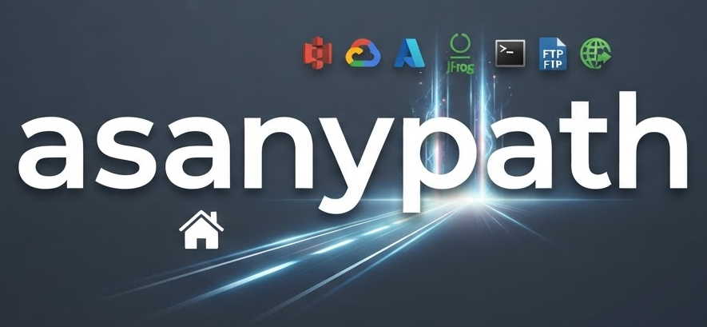

©2026 Axis Communications AB. AXIS COMMUNICATIONS, AXIS, ARTPEC and VAPIX are registered trademarks of Axis AB in various jurisdictions. All other trademarks are the property of their respective owners.

<p align="left">
  
</p>

AsAnyPath gives Python applications one asynchronous, pathlib-inspired API for
local files and cloud object storage. Use it when an application must copy,
read, list, or synchronize data without coupling its business logic to a single
storage provider.

The same code works with local disk, Amazon S3, Google Cloud Storage, Azure
Blob Storage, Artifactory, ssh, ftp, ftps, and plain HTTP(S). Typical uses include moving data
between cloud providers, writing backup tools, and testing storage workflows
locally before connecting to a cloud account.

## Requirements

- Python 3.10 through 3.14.
- Access credentials for each cloud service that your application uses.

S3 authentication accepts explicit keys or uses the AWS SDK credential provider
chain (including shared profiles and IAM roles) when keys are not supplied.
- A POSIX-compatible shell such as Bash or Zsh for the terminal commands below.
    Windows users can use Windows Subsystem for Linux or adapt the commands for
    PowerShell.
- Rust and a supported C compiler only when building the native extension from
    source. Published package wheels do not require a local Rust toolchain.

## Usage

```python
from asanypath import AsAnyPath

# The same API works for every backend — just change the URI scheme
path = AsAnyPath("s3://bucket/data.parquet")  # or gs://, az://, art://, file://, /local/path

data = await path.read_bytes()
await path.write_bytes(b"new content")
exists = await path.exists()
info = await path.stat()

# Iterate directories
async for child in path.parent.iterdir():
    print(child.name)

# List with metadata: is_dir always; size/mtime with stat=True.
# Fields the listing already reports cost no extra requests.
async for entry in path.parent.scandir(stat=True):
    print(entry.path.name, entry.is_dir, entry.size, entry.mtime)

# Glob
async for p in AsAnyPath("s3://bucket/logs/").glob("**/*.json"):
    print(p)

# Walk (like os.walk)
async for root, dirs, files in AsAnyPath("az://container/prefix").walk():
    for f in files:
        print(root / f)

# Presigned URLs (S3, GCS, Azure)
url = await path.presign(expires=3600, method="GET")
```

### File-like open (lazy range reads)

```python
# Binary streaming — only fetches the bytes you read (no full download)
async with path.open("rb") as f:
    header = f.read(64)

# Text mode with custom buffer size (controls prefetch chunk)
async with path.open("r", buffering=2_000_000) as f:
    first_line = f.readline()

# Sync works too
with path.open("rb") as f:
    f.seek(1024)
    chunk = f.read(512)
```

Files smaller than the buffer size are fetched in one shot automatically.
Supported on S3, GCS, Azure, and Artifactory.

HTTP and HTTPS paths also support read-only `open("rb")` and `open("r")`
with both context-manager styles. These download the entire response on entry
and return a seekable in-memory handle, so servers do not need to support HEAD
or range requests. Text mode accepts `encoding`, `errors`, and `newline`.
Existing HTTP authentication and read-cache settings apply; anonymous URLs
require no token.

### Service endpoints

S3, GCS, Azure and Artifactory paths expose a read-only `endpoint_url` property:

```python
path = AsAnyPath("s3://bucket/key", endpoint_url="https://storage.example.com")
print(path.endpoint_url)  # https://storage.example.com
```

This is the complete service base URL, including any service-root path such as
`/artifactory`, but excluding the bucket, container, repository and object path.
Reading it performs no I/O. For S3, it initially reflects an explicit override
or regional default; AWS configuration resolution during an operation can
update it. It is not necessarily the final per-request URL (for example, after
bucket addressing or redirects). Local, HTTP, SSH and FTP paths do not expose
this property.

### Copy and recursive delete

```python
# Copy a single file (cross-backend supported)
await src.copy(dst)

# Copy entire directory tree
await src.copy(dst, recursive=True)

# Remove directory and all its contents
await path.rmdir(recursive=True)
```

Copies automatically use spare transfer concurrency for large ranged reads.
The default target is 8 streams, with an 8 MiB minimum range size and at most
8 range streams per file. Files smaller than 16 MiB stay single-stream. When
enough files are active to meet the target, automatic copies use one request
per file instead of adding ranges. The target is best-effort, not a minimum
number of requests that must always be launched.

S3, GCS, Azure, Artifactory, SSH, and range-capable HTTP/HTTPS sources use the
shared reader for local downloads and source reads in cross-backend copies.
FTP/FTPS, sources without size metadata, and HTTP servers without advertised
range support retain single-stream downloads. Local-only copies and native
server-side copy/rename operations retain their existing implementations.
Large S3/Azure uploads also use concurrent parts within this shared budget.
GCS resumable sessions remain sequential because the protocol requires ordered
offsets.

Concurrent library copies share a default budget within the event loop. To
configure a batch explicitly:

```python
import asyncio
from asanypath import TransferBudget

with TransferBudget(floor=8, ceiling=32, min_range_size=8 * 1024 * 1024, per_file_cap=8):
    await asyncio.gather(*(src.copy(dst) for src, dst in pairs))
```

The ceiling bounds concurrent range reads and upload parts in this budget,
not metadata requests, single-request writes, or other processes. Parallel
buffers are bounded by active streams times their chunk sizes. Cross-backend
copies spool the downloaded source to a temporary file before using the
destination's upload API. S3/Azure then upload concurrent parts; destinations
without a streaming upload implementation can still buffer the complete write.
Same-backend server-side copies are unchanged.
`floor=1` disables automatic range splitting and makes upload parts sequential.
Explicit `chunk_size` requests retain sequential streaming when splitting
would be inappropriate, and `chunk_size=0` disables streaming to local paths.

S3/Azure ETags, GCS generations, and HTTP conditional requests pin the source
version when available. Other sources are checked against fresh metadata
after the download, which cannot guarantee a snapshot if the backend does
not expose a reliable change token. Use `atomic=True` to keep an existing
local destination intact on failure. Moves remove the source only after a
successful copy. The updated Python package requires the matching native
extension for conditional cloud reads.

For synchronous code (no `await` needed):

```python
from asanypath.sync import AsAnyPath

p = AsAnyPath("s3://bucket/data.parquet")
data = p.read_bytes()  # blocks until complete
p.write_bytes(b"new content")

for child in p.parent.iterdir():  # yields synchronously
    print(child.name)
```

Local paths (`file://` or bare `/path`) bypass the proxy entirely and use
`pathlib.Path` directly — zero threading overhead.

### Large uploads stream automatically

Writing or copying a large object never buffers the whole thing in memory — it
streams in bounded-size parts using each backend's native mechanism (S3
multipart, Azure block blobs, GCS resumable, SSH chunked writes, FTP data
connection, Artifactory streamed `PUT`). This is the **default** behaviour — no
flag, no API change:

```python
# open("wb") spills to disk past 16 MiB and uploads in parts on close
async with AsAnyPath("s3://bucket/huge.bin").open("wb") as f:
    f.write(data)

# local -> cloud copy streams straight from the source file (async and sync)
await AsAnyPath("/data/movie.mp4").copy("s3://bucket/movie.mp4")
```

S3 multipart and Azure block uploads send **up to 8 parts concurrently by
default**, filling freed slots without waiting for a whole batch. Concurrent
files share the budget rather than each multiplying the target concurrency.
At the default 8 MiB part size, a single large upload buffers up to **64 MiB of
part payload**, plus file spooling, transport and runtime overhead. Native part
requests borrow immutable Python bytes instead of copying each buffer again.
Objects smaller than one part upload in a single request.
(`write_bytes(data)` / `write_text(...)`
take the whole payload in memory by definition — use `open("wb")` or `copy()`
for large data; direct `write_bytes()` remains a single write.)

**Tuning throughput and memory.** Buffered part payload scales with part size
times concurrent upload slots. A slot is reserved before reading its part,
so queued uploads do not allocate unbounded buffers. Tune concurrency with
`TransferBudget(floor=..., ceiling=..., per_file_cap=...)`, or CLI
`--concurrency-floor` (also used by `cp`, `mv`, and `sync`). To limit a batch
to one in-flight part/range, use `TransferBudget(floor=1, ceiling=1)`.
Set part size globally via env, or per call:

```bash
export ASANYPATH_UPLOAD_CHUNK_SIZE=33554432   # 32 MiB parts (bytes)
export ASANYPATH_SPOOL_MAX_SIZE=67108864      # 64 MiB before open("wb") spills to disk
```

```python
# per call: copy(chunk_size=...) or, for writes, open(..., buffering=...)
await src.copy("s3://bucket/huge.bin", chunk_size=32 * 1024 * 1024)
async with dst.open("wb", buffering=32 * 1024 * 1024) as f:
    f.write(data)
```

Bigger parts mean fewer requests and a larger single-object ceiling (S3 allows
10,000 parts, so 8 MiB parts cap an object at ~80 GB). Backend minimums are
applied automatically: **S3** clamps to ≥ 5 MiB parts, **GCS** rounds down to a
256 KiB multiple.

On S3 failure or cancellation, in-flight workers are cancelled and joined
before aborting the multipart upload; completion lists remain in source order.
Azure only commits the ordered block list after all stages succeed; abandoned
uncommitted blocks are left for Azure's automatic expiry.

Unknown URI schemes now construct as `UnsupportedProtocolPath` placeholders.
Pure path operations (e.g. `.name`, `.parent`, joins) still work, while backend
operations (e.g. `.exists()`, `.read_bytes()`, `.open()`) raise
`UnsupportedProtocolError` on use.

### Credentials and derived paths

Credentials and endpoints passed to a constructor belong to that path and to
paths derived from it (`/`, `parent`, `with_name`, `with_segments`, listing
children). Independently constructed paths resolve their own credentials from
the environment, the keyring, or the backend's usual configuration:

```python
from asanypath.s3 import S3Path

p = S3Path("s3://bucket/data", endpoint_url="https://minio.local", aws_access_key_id="...",
           aws_secret_access_key="...")
child = p / "part-0.parquet"          # same endpoint and credentials
other = S3Path("s3://bucket/data")    # default AWS configuration
```

For backends whose credentials authenticate against the host in the URL
(Artifactory, SSH, FTP), explicit credentials never follow a derived path to a
different host. Listing results are only yielded when they name a direct child
of the listed path.

Ambient (environment) credentials belong to one configured service and are only
sent to that service's origin (scheme, host and port). Without a configured
service they are not sent at all, and a warning names the missing setting:

- **HTTP(S):** `HTTP_AUTH_USER`/`HTTP_AUTH_PASSWORD` or `HTTP_AUTH_TOKEN`
  (with optional `HTTP_AUTH_HEADER`) are only used for URLs on the origin of
  `HTTP_AUTH_URL`, e.g. `HTTP_AUTH_URL=https://files.example.com`. On a
  redirect to another scheme, host or port, only non-credential headers
  (`Range`, `Accept`, conditional headers, ...) are forwarded.
- **Artifactory:** `ARTIFACTORY_IDENTITY_TOKEN` is only used for the service in
  `ARTIFACTORY_BASE_URL` (or `ART_BASE_URL`). A JFrog CLI server token is only
  used for that server's own origin.
- **SSH:** host keys are checked like OpenSSH. `StrictHostKeyChecking`
  (`yes`, `ask`, `accept-new`, `no`) and `UserKnownHostsFile` are read from
  ssh_config; the default is `ask` against `~/.ssh/known_hosts`. Interactive
  sessions are prompted for a host with no recorded key; non-interactive ones
  refuse it. A changed key is refused, and with `StrictHostKeyChecking no`
  password authentication is disabled for it. Pass `known_hosts=()` (or set
  `SSH_KNOWN_HOSTS=none`) to disable checking.
- **Azure `presign()`** signs a blob-scoped SAS with the account key; a
  configured SAS token is never handed out as a presigned URL.

### Download caching (opt-in)

Reading the same object or URL twice always re-downloads it — there is **no
cache by default**, and the read path is unchanged unless you opt in, so
non-caching callers pay zero overhead.

Caching is included in the native extension with no extra dependencies or
installation extras. Opt in per read with `use_cache=True`:

```python
from asanypath import AsAnyPath

p = AsAnyPath("s3://bucket/model.bin")
data = await p.read_bytes(use_cache=True)   # first call fetches + stores
data = await p.read_bytes(use_cache=True)   # subsequent calls served from disk
text = await p.read_text(use_cache=True)
```

Configure the location and limits once (location defaults to
`~/.cache/asanypath`, honoring `$XDG_CACHE_HOME` and `$ASANYPATH_CACHE_DIR`):

```python
from asanypath import configure_cache

configure_cache(
    directory="/var/cache/asanypath",  # default: ~/.cache/asanypath
    size_limit=2 * 1024**3,            # stored key + payload budget (default 1 GiB, LRU)
    ttl=3600,                          # per-entry expiry in seconds (default: none)
    enabled=True,                      # make use_cache default to True process-wide
)
```

Or via environment: `ASANYPATH_CACHE_DIR`, `ASANYPATH_CACHE_SIZE_LIMIT` (bytes),
`ASANYPATH_CACHE_TTL` (seconds).

Behaviour and trade-offs:

- **Off by default, opt-in per call.** With `configure_cache(enabled=True)` the
  default flips process-wide; an explicit `use_cache=False` always bypasses.
- **Works for every remote backend** (S3, GCS, Azure, Artifactory, HTTP, SSH,
  FTP). Local paths are never cached.
- **Size-bounded, LRU-evicted;** disk I/O runs in a worker thread so the
  event loop stays responsive. Concurrent reads of the same key collapse to a
  single fetch within a cache instance. The byte budget counts UTF-8 keys and
  payloads; SQLite metadata and transaction journals add filesystem overhead.
  Objects larger than the budget are returned without being cached.
- **Byte-only native storage:** SQLite stores raw bytes, never Python pickles.
  The database lives under `native-v1/` in the configured cache directory,
  readable only by its owner (directory `0700`, files `0600` on POSIX).
  Legacy DiskCache files are ignored, not migrated or deleted. Multiple
  processes of the same user can share the new store; use the same size limit
  across them.
- **Scoped to credentials.** Entries are keyed by URL plus a hash of the
  path's credentials and endpoint, so different identities never share an
  entry. Credentials themselves are never written to the cache. A cached entry
  is not revalidated, so revoking an identity's access upstream does not evict
  what it already cached.
- **Staleness is on you.** Entries are keyed by URL with no revalidation — a
  cached object that changes upstream is served stale until it expires (`ttl`)
  or is evicted. Prefer caching immutable/versioned objects, or set a `ttl`.

### Resumable downloads

`download(dst)` streams an object to a local file and **resumes an interrupted
transfer** instead of starting over:

```python
await AsAnyPath("s3://bucket/huge.bin").download("/data/huge.bin")
# process killed mid-download... run the same call again — it continues
await AsAnyPath("s3://bucket/huge.bin").download("/data/huge.bin")
```

Bytes stream into `<dst>.part` with a `<dst>.part.meta` sidecar recording the
object's ETag (or `Last-Modified`) and total size. On resume the identity is
re-checked: if the upstream object is unchanged the download continues from the
saved offset; if it changed, the partial is discarded and it restarts cleanly.
On completion `<dst>.part` is atomically renamed to `dst`.

```python
# tune the range-request size; disable resume to always start fresh
await path.download("/data/huge.bin", chunk_size=32 * 1024 * 1024, resume=False)
```

Resume needs range reads **and** a HEAD probe, so it's available on the object
stores (S3/GCS/Azure) and Artifactory/HTTP where the server supports it.
Backends without those (e.g. FTP) download in a single pass automatically. This
needs no extra dependency — resume state is plain sidecar files, independent of
the optional download cache.

## Installation

Most cloud backends (S3, GCS, Azure, Artifactory, HTTP) are included in the base
install — no per-backend extras needed.

The following commands install from a checked-out source repository in a
POSIX-compatible shell. Public package-install instructions will be added when
the PyPI distributions are published.

```bash
# Core development environment (includes the most common cloud backends)
uv sync

# With CLI
uv sync --extra cli

# With FTP backend support (SSH/SFTP is built in — no extra needed)
uv sync --extra ftp

# With OS keyring-backed credential cache
uv sync --extra credstore

# With benchmark dependencies
uv sync --extra bench

# Full install all cloud backends
uv sync --extra all
```


### Cloud Backend Status

| Backend | Status | Authentication | Operations |
|---------|--------|----------------|-----------|
| Local FS | ✅ Full | N/A | All async pathlib methods |
| S3 | ✅ Full | AWS credentials / SigV4 | read/write/list/delete/stat/checksums/presign |
| GCS | ✅ Full | Service account / token | read/write/list/delete/stat/checksums/presign |
| Azure | ✅ Full | Account key / SAS token | read/write/list/delete/stat/checksums/presign |
| Artifactory | ✅ Full | Bearer token | read/write/list/delete/stat/checksums |
| HTTP(S) | ✅ Full | N/A | read (GET) |

## CLI Usage

```bash
# Install with CLI support
uv sync --extra cli

# List supported protocols
asanypath protocols

# Check if a file exists
asanypath exists s3://bucket/file.txt

# Print file contents
asanypath cat s3://bucket/file.txt

# List directory in columns; directories end with "/", dotfiles need -a
asanypath ls s3://bucket/prefix/
asanypath ls -a s3://bucket/prefix/

# Long listing (size, modified) and tree view
asanypath ls -l s3://bucket/prefix/
asanypath ls -r -d 2 s3://bucket/prefix/

# List directory (Artifactory with token)
asanypath ls art://repo/path/ --token mytoken

# Copy local → cloud
asanypath cp /local/file.txt s3://bucket/file.txt

# Copy cloud → local
asanypath cp s3://bucket/file.txt /local/file.txt

# Allow 32 concurrent files; fill spare capacity toward 8 streams for large files
asanypath cp -r s3://bucket/data/ ./data/ -j 32 --concurrency-floor 8

# Disable automatic range splitting (also supported by mv and sync)
asanypath cp s3://bucket/file.txt ./file.txt --concurrency-floor 1

# Delete a file
asanypath rm s3://bucket/file.txt --force

# Move / rename
asanypath mv s3://bucket/old.txt s3://bucket/new.txt

# Create directory
asanypath mkdir s3://bucket/new-prefix/ --parents

# File statistics
asanypath stat s3://bucket/file.txt

# Presigned URLs (S3, GCS, Azure — 1h default)
asanypath presign s3://bucket/file.txt
asanypath presign gs://bucket/file.txt --expires 7200
asanypath presign az://container/file.txt --method PUT

# Auth diagnostics
asanypath auth show

asanypath auth show s3://bucket
```

### Shell Completions (Beta)

Path completions are available for all subcommands that take cloud paths: `ls`, `cp`, `mv`, `rm`, `stat`, `cat`, `exists`, `touch`, `checksums`, `mkdir`, `presign`, and `sync`.

Completions complete cloud paths up to 50 items deep with shallow enumeration (immediate children only), and are cached for 30 seconds per prefix to avoid redundant backend requests.

**Bash Setup:**

```bash
# One-time for current shell
eval "$(asanypath completion bash)"

# Persist in ~/.bashrc
echo 'eval "$(asanypath completion bash)"' >> ~/.bashrc
```

**Zsh Setup:**

```bash
# One-time for current shell
eval "$(_ASANYPATH_COMPLETE=zsh_source asanypath)"

# Persist in ~/.zshrc
echo 'eval "$(_ASANYPATH_COMPLETE=zsh_source asanypath)"' >> ~/.zshrc
```

If you run `asanypath` from a virtual environment path, use that exact executable
in the eval command, for example:

```bash
eval "$(/path/to/venv/bin/asanypath completion bash --exe /path/to/venv/bin/asanypath)"
```

If completions still do not appear, verify and rebind in the current shell:

```bash
# Ensure shell command cache is refreshed
hash -r

# Confirm which executable is active
command -v asanypath

# Remove stale completion binding (if any)
complete -r asanypath 2>/dev/null || true

# Rebind completions against the active executable
eval "$(_ASANYPATH_COMPLETE=bash_source "$(command -v asanypath)")"

# Verify completion is registered
complete -p asanypath
```

Tip: if `asanypath` comes from a project venv, prefer putting the explicit venv path in your shell rc file instead of relying on PATH ordering.

**Usage:**

```bash
asanypath ls s3://bucket/pre[TAB]      # Completes to matching S3 prefixes
asanypath cp s3://src/fi[TAB] ./[TAB]  # Completes both source and destination
asanypath rm s3://[TAB]                # Lists buckets
```

Completion respects environment variables for cloud credentials (e.g., `AWS_ACCESS_KEY_ID`, `AWS_SECRET_ACCESS_KEY` for S3). Bearer token auth (for custom endpoints) is not supported in completions; only env var-based auth is used.

### Path options in your own click CLI

`click.Path` validates with `os.stat()`, so with `path_type=AsAnyPath` its
`exists`, `file_okay` and `dir_okay` checks are skipped for remote URIs
(`exists=False`) or always fail (`exists=True`). Use `ClickPath` instead
(requires the `cli` extra):

```python
import click
from asanypath.click import ClickPath

@click.command()
@click.option("--model", type=ClickPath(exists=True, dir_okay=False))
@click.option("--out", type=ClickPath(file_okay=False))
def main(model, out):
    ...  # model and out are sync AsAnyPath objects
```

`ClickPath` takes the same arguments as `click.Path`; `path_type` defaults to
`asanypath.sync.AsAnyPath`. Local paths (including `file://` URIs) behave exactly
like `click.Path`. Remote paths are checked with `exists()`, `is_dir()` and
`is_file()` while arguments are parsed:

- `file_okay=False` / `dir_okay=False` reject a path only when it is exclusively
  the disallowed kind; an object-store key can be both a file and a directory.
- `readable`, `writable`, `executable` and `resolve_path` apply to local paths only.
- If the backend cannot be queried (credentials, network, unsupported protocol),
  `exists=True` reports the error and `exists=False` accepts the path unchecked.

## Benchmarks

Multi-backend benchmark suite in `scripts/bench.py` compares asanypath against
fsspec, cloudpathlib, and native async SDKs. Run against live services or local
emulators (`compose.yml` provides MinIO, Azurite, and fake-gcs-server).

```bash
# Local only (no cloud creds needed)
uv run --extra bench python scripts/bench.py --backend local --rounds 3

# Single backend
uv run --extra bench python scripts/bench.py --backend s3 --rounds 5

# All backends
uv run --extra bench python scripts/bench.py --backend all --rounds 3 --objects 10

# Sweep concurrency levels
uv run --extra bench python scripts/bench.py --backend art --rounds 3 --concurrency-levels 1,10,50
```

For multipart upload throughput, use `scripts/bench_upload.py` with real shard
files and an explicitly selected S3-compatible endpoint:

```bash
uv run --extra bench python scripts/bench_upload.py \
  --destination s3://my-bucket/bench --endpoint-url https://my-storage-endpoint \
  --part-mib 8 --streams 1 8 --rounds 3 /data/shard-001 /data/shard-002
```

This compares asanypath and boto3 using one shared request budget per client.
It warms up each case, reports JSON timings and MiB/s, verifies uploaded contents
outside the timed interval, and deletes only the uniquely named benchmark
objects it created. Both clients use normal AWS credentials (or `--profile`).
Run with one large shard and again with several representative shards; results
from a local test server are not evidence of production endpoint throughput.

### S3 — live S3-compatible service (median of 20 rounds, 10 objects, c=1)

| Operation | asanypath | s3fs | aiobotocore | cloudpathlib |
|-----------|-----------|------|-------------|--------------|
| write | **8.80 ms** | 12.67 ms | 28.07 ms | 41.75 ms |
| read | **3.78 ms** | 9.10 ms | 23.15 ms | 12.83 ms |
| exists | **3.57 ms** | 4.25 ms | 21.92 ms | 4.02 ms |
| iterdir | 40.55 ms | 39.16 ms | 56.49 ms | **39.07 ms** |

### Azure — Azurite emulator (median of 20 rounds, 10 objects, c=1)

| Operation | asanypath | azure-sdk | adlfs | cloudpathlib |
|-----------|-----------|-----------|-------|--------------|
| write | **1.24 ms** | 1.79 ms | 2.34 ms | 7.88 ms |
| read | **0.51 ms** | 1.15 ms | 2.44 ms | 3.19 ms |
| exists | **0.35 ms** | 0.95 ms | 0.98 ms | 1.04 ms |
| iterdir | **0.88 ms** | 2.40 ms | 4.11 ms | 2.72 ms |

### GCS — fake-gcs-server emulator (median of 20 rounds, 10 objects, c=1)

| Operation | asanypath | gcloud-aio | cloudpathlib | gcsfs |
|-----------|-----------|------------|--------------|-------|
| write | **0.45 ms** | 0.51 ms | 3.53 ms | 0.58 ms |
| read | 0.22 ms | **0.18 ms** | 1.48 ms | 0.30 ms |
| exists | **0.15 ms** | 0.18 ms | 0.50 ms | 0.46 ms |
| iterdir | **0.19 ms** | 0.25 ms | 0.69 ms | 0.33 ms |

### Artifactory — live server (median of 20 rounds, 10 objects, c=1)

| Operation | asanypath | aiohttp | requests |
|-----------|-----------|---------|----------|
| write | **54.49 ms** | 54.75 ms | 57.57 ms |
| read | **2.83 ms** | 3.09 ms | 12.01 ms |
| exists | 2.33 ms | **2.18 ms** | 4.61 ms |
| iterdir | **2.85 ms** | 3.07 ms | 7.88 ms |

### SSH / SFTP — localhost emulator (median of 20 rounds, 10 objects, c=1)

asanypath uses a built-in native russh SFTP transport (off-GIL); `asyncssh` is
shown only as a benchmark baseline.

| Operation | asanypath | asyncssh |
|-----------|-----------|----------|
| write | **0.16 ms** | 0.33 ms |
| read | **0.21 ms** | 0.36 ms |
| exists | **0.07 ms** | 0.11 ms |
| iterdir | **0.23 ms** | 0.44 ms |

### FTP — localhost emulator (median of 20 rounds, 10 objects, c=1)

| Operation | asanypath | aioftp |
|-----------|-----------|--------|
| write | **0.35 ms** | 0.41 ms |
| read | **0.35 ms** | 0.40 ms |
| exists | **1.00 ms** | 1.13 ms |
| iterdir | 1.09 ms | **1.04 ms** |

Latencies are per-operation medians over 20 rounds. S3 and Artifactory ran
against live services; Azure, GCS, SSH/SFTP, and FTP against local emulators
(Azurite, fake-gcs-server, and localhost sftp/ftp), so those figures reflect
client-library overhead, not WAN latency. The SSH/SFTP transport is a built-in
native russh backend that runs SFTP off-GIL and beats asyncssh on every
operation. asanypath matches or beats dedicated client libraries on most
operations while providing a single unified API across all backends.

## How It Works

`AsAnyPath` dispatches on the URI scheme to return the right path class:

| Protocol | Class | Transport |
|----------|-------|-----------|
| `file://` or bare path | `AsyncPath` | `anyio` / `pathlib` |
| `s3://` | `S3Path` | reqwest + SigV4 |
| `gs://`, `gcs://` | `GCSPath` | reqwest + JSON API |
| `az://`, `azure://` | `AzurePath` | reqwest + SharedKey |
| `art://` | `ArtifactoryPath` | reqwest + Bearer |
| `http://`, `https://` | `HTTPPath` / `HTTPSPath` | reqwest |
| `ssh://` | `SSHPath` | native russh (SFTP) |
| `ftp://` | `FTPPath` | `aioftp` |
| `ftps://` | `FTPSPath` | `aioftp` + TLS |
| any other scheme | `UnsupportedProtocolPath` | none — pure-path only |

Cloud and HTTP network I/O is handled by `asanypath-native` (Rust/PyO3 + reqwest)
with jittered exponential backoff retry for transient errors. SSH/SFTP uses a
built-in off-GIL native russh transport (no Python SSH dependency); FTP/FTPS use
`aioftp`. Unknown schemes construct an `UnsupportedProtocolPath`: pure-path
operations (`.name`, `.parent`, joins) work, while any backend operation raises
`UnsupportedProtocolError`.

## API Reference

### `AsAnyPath(path, **kwargs)`

Factory that returns the appropriate path instance based on the URI scheme.

### Async Methods

All path implementations support:

- `open(mode, buffering)` — file-like streaming with lazy range reads; for writes, `buffering` sets the upload part size
- `copy(dst, recursive, chunk_size)` — copy file or tree (cross-backend); `chunk_size` tunes the upload part size
- `download(dst, resume, chunk_size)` — stream an object to a local file, resuming an interrupted transfer
- `read_bytes()` / `write_bytes(data)` — `read_bytes(use_cache=True)` serves from / stores in the opt-in [download cache](#download-caching-opt-in)
- `read_text(encoding)` / `write_text(data, encoding)` — `read_text` also accepts `use_cache`
- `exists()` / `is_file()` / `is_dir()` — `exists()` is true for files and directories,
  like a local path. On object stores (S3, GCS, Azure) a non-empty prefix is a
  directory, looked up only when no object exists at the key; a key can be both an
  object and a prefix, so `is_file()` and `is_dir()` may both be true. Empty
  directories don't exist there (`mkdir()` is a no-op).
- `stat()` / `checksums()` (cloud backends)
- `mkdir(parents, exist_ok)` / `touch(exist_ok)`
- `unlink(missing_ok)` / `rmdir(recursive)`
- `iterdir()` / `scandir(stat)` / `rename(target)`
- `get_access_policy()` / `update_access_policy(policy_patch)`

### Backend Operation Options

Operations which make provider requests accept a keyword-only `backend_options`
value for provider-native configuration. Options are attached to one operation,
not to the path or its credentials, and remain distinct when uploads are
batched. `copy()`, `move()`, `rename()`, and `replace()` use
`destination_backend_options` because they configure the destination request.

```python
from asanypath import BackendOptions, S3Path

path = S3Path("s3://bucket/report.json")
await path.write_bytes(
    payload,
    backend_options=BackendOptions(
        headers={"content-type": "application/json", "x-amz-meta-source": "etl"},
        query={"x-id": "PutObject"},
    ),
)
```

`BackendOptions` has three independent mappings:

| Field | Purpose | Availability |
|---|---|---|
| `headers` | Additional HTTP request headers | S3, GCS, Azure, and Artifactory data operations |
| `query` | Additional HTTP query parameters | S3, GCS, Azure, and Artifactory data operations |
| `provider` | Structured backend-specific operation settings | GCS object-resource fields; local policy symlink behavior; Artifactory permission-target selection |

Authentication, `Host`, and `Content-Length` remain owned by asanypath. On GCS
uploads, `provider` supplies object-resource fields and selects a multipart
upload. Other data backends reject unsupported `provider` values rather than
silently dropping them. `provider` is also used by policy operations as
described below; it is not automatically forwarded as HTTP request data.

For S3 metadata replacement, provide both `x-amz-metadata-directive: REPLACE`
and the desired `x-amz-meta-*` headers. Headers and query parameters are
additive: they cannot override credentials or protocol-critical values.

### Access Policies

`get_access_policy()` returns an `AccessPolicy` with `owner`, `group`,
normalized `grants`, and a provider-native `provider` mapping. A grant
principal is backend-defined: local, SSH, and FTP paths use `owner`, `group`,
and `everyone`; object stores use provider principal strings such as
`user:reader@example.com` or `canonical-user:<id>`.

Normalized actions are `read`, `write`, and `execute`. They deliberately do
not flatten every provider-specific permission. The complete provider document
is kept in `policy.provider` so a read-modify-replace workflow does not discard
permissions, principals, or scope that lack a portable equivalent.

```python
from asanypath import AccessGrant, AccessPolicyPatch, AsyncPath

path = AsyncPath("report.txt")
await path.update_access_policy(
    AccessPolicyPatch(
        grants=(
            AccessGrant("group", frozenset({"read"})),
            AccessGrant("everyone", frozenset()),
        )
    )
)
```

For local paths, grants map to POSIX owner, group, and other mode bits;
`owner` and `group` map to ownership changes. Backend-specific controls are
passed through `BackendOptions`, for example
`BackendOptions(provider={"follow_symlinks": False})` on local paths.

| Backend | Policy scope | Read | Update |
|---|---|---|---|
| Local | Path | POSIX mode and local owner/group names | POSIX mode and ownership; `follow_symlinks` option |
| SSH/SFTP | Path | POSIX mode and numeric uid/gid | SFTP `chmod` and `chown` |
| FTP/FTPS | Path | MLST `unix.mode`, when provided by the server | `SITE CHMOD`, when supported; ownership is unavailable |
| S3 | Object | Object ACL | Complete `s3_acl` document |
| GCS | Object | Object ACL | Complete `gcs_acl` document |
| Azure Blob | Container | Public access and stored SAS policies | Complete `azure_container_acl` document |
| Artifactory | Named permission target | Target selected by `permission_target` option | Complete `artifactory_permission_target` document |

S3 and GCS normalize only their unambiguous read/write permissions. Azure
maps public blob/container access to an `everyone` read grant. These calls do
not evaluate S3 bucket policies, GCS IAM, Azure RBAC, ADLS Gen2 ACLs, or
effective access.

Cloud ACL updates require the complete native document returned by the matching
read. This makes replacement explicit and preserves fields outside the
portable policy model:

```python
from asanypath import AccessPolicyPatch, AsyncPath

path = AsyncPath("s3://bucket/report.json")
policy = await path.get_access_policy()
await path.update_access_policy(AccessPolicyPatch(provider={"s3_acl": policy.provider["s3_acl"]}))
```

Artifactory operations are target-scoped rather than artifact-scoped because a
target can cover several repositories and path patterns. Select it explicitly
for both calls:

```python
from asanypath import AccessPolicyPatch, AsyncPath, BackendOptions

path = AsyncPath("art://artifactory.example.com/artifactory/generic/report.json")
options = BackendOptions(provider={"permission_target": "release-readers"})
policy = await path.get_access_policy(backend_options=options)
await path.update_access_policy(
    AccessPolicyPatch(
        provider={"artifactory_permission_target": policy.provider["artifactory_permission_target"]}
    ),
    backend_options=options,
)
```

The remote server remains authoritative. Missing privileges, disabled ACL
features, unsupported FTP extensions, and invalid provider documents raise the
provider's normal authorization or validation error. Missing required local
policy context, such as an Artifactory permission target or complete cloud ACL
document, raises `ValueError` before a request is sent.

The remaining cloud backends raise `NotImplementedError` rather than silently
translating provider IAM or ACL models.

### Properties

- `name`, `stem`, `suffix`, `parent`, `parts`
- `protocol` — URI scheme (`s3`, `gs`, `az`, `art`, `file`, …)

## Development

Run these commands in a POSIX-compatible shell such as Bash or Zsh:

```bash
git clone https://github.com/AxisCommunications/asanypath.git
cd asanypath

# Install with dev dependencies
uv sync --extra dev

# Run tests
uv run pytest

# Build Rust native accelerator (optional)
cd rust && PYO3_USE_ABI3_FORWARD_COMPATIBILITY=1 uv tool run maturin develop --release
```

## License

[MIT](./LICENSE)
